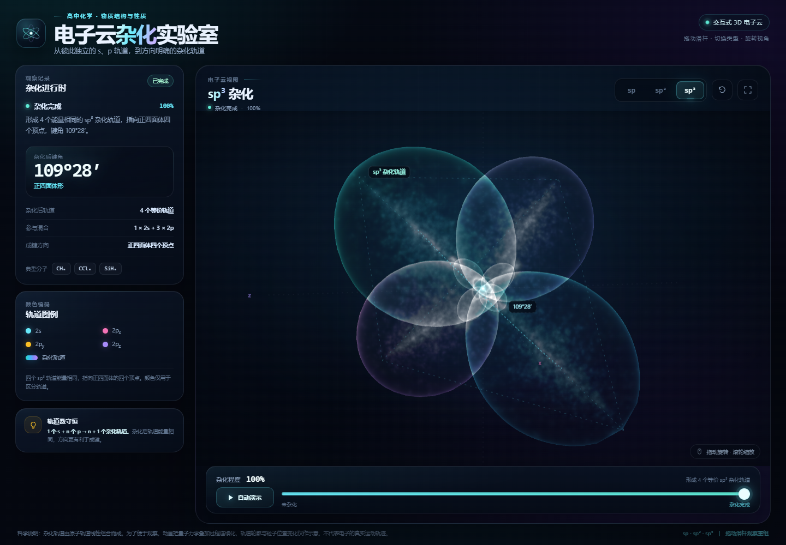

# 高中化学可视化平台

面向高中化学课堂的交互式可视化项目。把抽象的轨道、构型和反应过程，变成可以拖动、旋转、观察的 3D 画面。



## 在线访问

```text
https://chemleon6657.github.io/chemistry-visual-lab/
```

## 页面结构

| 页面 | 内容 | 文件 |
| --- | --- | --- |
| 平台首页 | 平台介绍、模块导航、后续模块预告 | `index.html` |
| 电子云杂化实验室 | sp / sp² / sp³ 杂化过程、键角、空间构型、典型分子 | `electron-cloud.html` |

## 已上线模块

### 电子云杂化实验室

- 拖动「杂化程度」滑杆，从 0% 未杂化到 100% 杂化完成。
- 支持 sp、sp²、sp³ 三种类型切换。
- 展示参与混合的 s / p 轨道，以及未参与杂化的 p 轨道。
- 包含键角、空间构型、典型分子和自动演示。
- 支持拖动旋转、滚轮缩放、全屏观察。

## 规划中的模块

- 分子空间构型：VSEPR 与空间构型判断
- 晶体结构：晶胞、离子晶体、分子晶体与原子晶体
- 反应机理：取代、加成、消去与能量变化

## 特点

- 单文件 HTML，无外部 CDN、无第三方框架，离线也能打开。
- 原生 WebGL 渲染半透明轨道曲面与粒子电子云。
- 支持手机、平板和桌面端。
- 支持 `?type=sp|sp2|sp3&t=0..1` 参数，便于课堂预设画面。

## 本地预览

直接双击 `index.html`，或在当前目录运行：

```powershell
py -m http.server 8000
```

然后打开 `http://localhost:8000/`。

## 添加新模块

1. 新建独立 HTML 页面，例如 `vsepr.html`。
2. 在 `index.html` 的模块网格中加入入口卡片。
3. 保持单文件优先；如需资源，放在 `assets/` 下并使用相对路径。
4. 推送到 `main` 分支，GitHub Pages 会自动更新。

## 科学说明

杂化轨道由原子轨道线性组合而成。页面为了便于观察，将量子力学叠加过程连续化，轨道轮廓与粒子位置变化仅作教学示意，不代表电子真实运动轨迹。

## 技术

- HTML / CSS / JavaScript
- WebGL 1.0
- 无构建步骤，推送即发布
